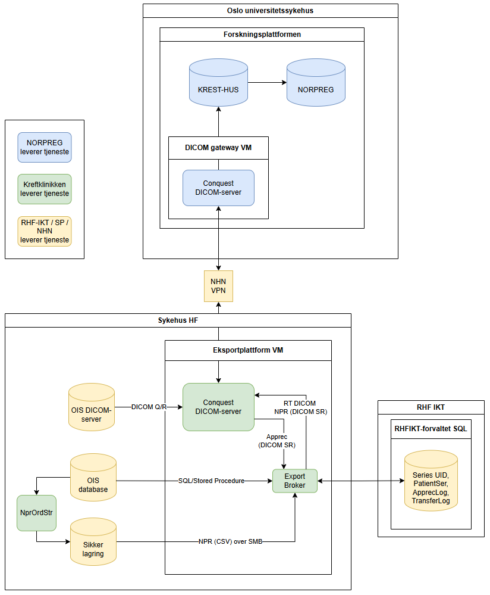

# Eksportplattform

Dette prosjektet automatiserer eksport av stråleterapi-relaterte DICOM-data fra **ARIA** til **Conquest PACS**, og videre til eksterne mottakere (KREST / NORPREG).

Scriptet finner behandlingsplaner opprettet etter en gitt dato, bygger en komplett DICOM-studiestruktur (RTPLAN → RTDOSE → RTSTRUCT → CT), overfører manglende objekter via Dicom Query / Retrieve fra Aria DCM til Conquest, og sender deretter studien videre til KREST-XXX / NORPREG.

En overordnet beskrivelse er gitt i figuren under:


# Formål

Systemet sikrer at:

* komplette stråleterapiplaner eksporteres
* alle nødvendige DICOM-objekter følger med
* eksporten kan spores og reproduseres (MSSQL).
* DICOM Apprec mottas via DICOM SR på pasientnivå og evt. feil logges i databasen (MSSQL). Se mer detaljer om hvordan disse lages i [NORPREG-repoet](github.com/NORPREG/NORPREG).

---

# Oversikt

Arbeidsflyten er:

For DICOM:
1. Hent alle RT plan-sett fra ARIA etter en gitt dato
2. For hver pasient:
   * Finn RT Plan og tilhørende RT Dose via ARIA DB integrasjon. En [Stored Procedure er laget for dette formålet](resources/blp_GetTxRecordsProtonToExport.sql).
   * Finn referert RT Structure Set fra RT Plan-filen
   * Finn CT-serier referert fra Structure Set
3. Last ned DICOM-objekter fra ARIA til lokal Conquest via C-MOVE. Dette gjøres i [Aria Dicom-grensesnittet](module/interfaces/aria_dicom_interface.py).
4. Send komplett datasett videre til:
   * Intern Conquest-node (denne var nødvendig for å sørge for to lyttende porter, anbefaler å sette opp intern port mot OIS som 314XX -- samme som mot KREST-XXX.
   * KREST-XXX
5. Logg eksporterte pasienter i en eksportdatabase (MSSQL). [Se LogDatabase-grensesnittet her](module/interfaces/export_logger_interface.py).
6. Finn mottatte applikasjonskvitteringer (apprec): Basic Text SR med `SeriesDescription = "Apprec"`
7. Legg alle apprec-hendelser inn i databasen, knyttet mot riktig pasient

For NPR:
1. Let i `config.config.npr.root_dir` (enten flat struktur eller per år) etter nye alle eksisterende NPR-filer
2. Kontroller alle identifiserte filer mot allerede sendte filer. Dette gjøres basert på filnavn + md5-hash
3. Pakk NPR-filen (UTF-8 CSV tekst) inn i en DICOM SR container. Bruk en KREST-XXX-basert UID med pasientnavn "NPR^FILE"
4. Send denne filen til KREST-XXX

Dette sikrer at komplette behandlingsdatasett blir eksportert konsistent.

TODO: RT Treatment Record eksport kræsjer pga. bug i Aria (når det er ° i FieldId...).

---

# Arkitektur

Scriptet fungerer som en **orkestrator** som koordinerer flere grensesnittmoduler:

```
ARIA Database
      │
      ▼
aria_db_interface
      │
      ▼
PlanSet struktur
      │
      ▼
ARIA DICOM (C-MOVE)
aria_dicom_interface
      │
      ▼
Conquest PACS
      │
      ├─ conquest_db_interface
      │
      └─ conquest_dicom_interface
             │
             ▼
      Eksterne mottakere
      (NORPREG / KREST)
```

---

# Datastruktur

`plan_set` representerer behandlingsdata organisert per pasient:

```
PatientSer {
    "PatientID",
    "PlanSet": {
        RT Plan SOP UID: {
            "RTPLAN": RT Plan SOP UID,
            "RTPlanLabel": "...",
            "RTDOSE": {Dose SOP UID},
            "RTSTRUCT": {Structure SOP UID},
            "RTRECORD": [Treatment Record UID],
            "CT": {Series Instance UID}
        }
    }
}
```

Denne strukturen bygges opp gradvis mens scriptet finner refererte objekter.

---

# Arbeidsflyt

## 1. Finn plan-sett

```python
plan_set = aria_db_interface.get_plan_set(dt)
```

Returnerer alle pasienter med RT Plan opprettet etter en gitt dato.

---

## 2. Kontroller om pasienten allerede er eksportert

Eksportdatabasen brukes til å unngå duplikater.

```python
sent_dt = log_database.check_patient(patient_ser)
```

`orchestrator.check_for_changes_and_errors(plan_set)` returnerer en ny `plan_set_changes`
med samme pasientmetadata og kun objekt-UID-er som ikke er logget som sendt.
Uendrede planer utelates; uten endringer er `plan_set_changes["PlanSet"]` tom.
Plan-UID som nøkkel og `RTPlanLabel` beholdes som kontekst, mens hver
modalitet inneholder et sett med kun nye UID-er. Sammenligningen skjer
per pasient, plan, modalitet og UID-type. Siste forsøk med utfylt `SentDt`
avgjør status; ved likt tidspunkt brukes høyeste transfer-ID og objekt-ID.
CT sammenlignes på serie-UID, øvrige
modaliteter på SOP-UID. Feilede objekter og eldre rader uten eksplisitt
suksessstatus blir forsøkt igjen ved neste kjøring.
Funksjonen endrer ikke `plan_set`. UID-er med status 0 på siste forsøk legges
til selv om de mangler i dagens uttrekk, også RTSTRUCT og CT. Dette gjelder
kun planer som finnes i dagens pasientuttrekk. En eldre feil etterfulgt av
suksess utløser ikke retry. Historiske objekter uten siste status 0 som ikke
finnes i dagens uttrekk, og endringer i etiketter eller rekkefølge, utløser
ikke ny eksport.
Hovedprogrammet bruker endringsstrukturen videre i stedet for å hoppe over
pasienter som finnes lokalt i Conquest. RTPLAN/RTSTRUCT kan fortsatt hentes
lokalt fra ARIA for å finne referanser. Etter at RTSTRUCT og CT er funnet,
filtreres historiske UID-er bort igjen før intern videresending. Til KREST
sendes kun de valgte SOP-UID-ene og CT-serie-UID-ene, og kun disse loggføres.

---

## 3. Verifiser RTPLAN og RTDOSE

Scriptet sjekker om disse finnes i Conquest.

Hvis ikke:

```
ARIA → C-MOVE → Conquest
```

---

## 4. Finn RTSTRUCT

Fra RT Plan-filen hentes referert Structure Set.

Hvis mangler:

```
ARIA → C-MOVE → Conquest
```

---

## 5. Finn CT-serie

Fra RTSTRUCT identifiseres refererte CT-serier.

Hvis serien ikke finnes i Conquest:

```
ARIA → C-MOVE → Conquest
```

---

## 6. Send komplett studie

Når alle nødvendige objekter finnes:

```
Conquest (Medfys-1) → Conquest (Medfys-2)
Conquest (Medfys-2) → KREST-HUS
```

Merk at det her benyttes to Conquest-instanser. Det er fordi ulike port-rekkevidder måtte benyttes mot Aria (via "medfys-1") og KREST-HUS (via "medfys-2").
Derfor må dataene først flyttes fra "medfys-1" til "medfys-2" før de kan overføres til KREST-HUS, da via en C-MOVE.
# TODO: Ved en senere endring i Aria DCM-tjenesten kan Conquest-noden rekonfigureres så den snakker med både Aria og KREST.

Dette gjøres via:

```python
conquest_dicom_interface.c_move_to_medfys2(...)
conquest_dicom_interface.c_move_to_krest_hus(...)
```

C-MOVE leser responsene til sluttstatus, og C-STORE kontrollerer
statusdatasettet direkte. Status `0x0000` gir `(1, "")`; feil, advarsler,
avbrudd og manglende sluttstatus gir `(0, feilmelding)` og logges.
Resultatene følger hvert objekt i planens `TransferResults` gjennom ARIA,
intern Conquest og KREST. Feilede objekter sendes ikke videre; uavhengige
objekter og neste pasient fortsetter. Ved feil på RTPLAN hoppes avhengige
objekter over, og ved feil på RTSTRUCT hoppes avhengige CT-serier over.
`DicomObject.TransferStatus` lagrer sluttresultatet (1 = pass, 0 = fail),
og `TransferMessage` forklarer feil eller hvorfor objektet ble hoppet over.
`DicomTransfer.SentDt` er tidspunktet for eksportforsøket, ikke bevis på at
alle objektene ble sendt.
For feilede objekter kan `BytesStored` være `NULL`.
Databasefeil og programmeringsfeil skjules ikke. C-FIND er et oppslag,
ikke en overføring, og gir fortsatt feil ved ugyldig eller ufullstendig respons.
Associations frigjøres også ved overføringsfeil. Feilede NPR-sendinger logges
og hoppes over uten å registreres som sendt. C-STORE for NPR bekrefter lagring
i lokal Conquest, ikke endelig behandling hos KREST/NORPREG.

For en eksisterende database må de nye kolonnene legges til før kjøring:

```sql
ALTER TABLE dbo.DicomObject ADD TransferStatus int NULL,
    TransferMessage nvarchar(max) NULL;
ALTER TABLE dbo.DicomObject ADD CONSTRAINT CK_DicomObject_TransferStatus
    CHECK (TransferStatus IN (0, 1));
```

Hvis `TransferStatus` allerede finnes som tekstkolonne, må eksisterende
verdier konverteres til 1/0 og kolonnen endres til `int` før kjøring.

Statuskontrollene kan testes uten nettverk eller produksjonskonfigurasjon:

```powershell
python -m unittest discover -s tests -p "test_dicom_status.py"
```

---

# Konfigurasjon

## Eksportdatabase (MSSQL)

[resources/Eksportplattform.sql](resources/Eksportplattform.sql) oppretter tabellene
`DicomTransfer`, `RTPlan`, `DicomObject`, `NPRFile` og `Apprec` i en eksisterende
`ProtonRegister`-database. Tabeller, kolonnenavn og relasjoner følger
[export_logger_dataclass.py](module/Dataclasses/export_logger_dataclass.py).
Endre `USE [ProtonRegister]` dersom databasen har et annet navn.

Skriptet er for nyopprettelse, ikke migrering av eksisterende tabeller, og sletter
ingen data. Opprettelsen kjøres i en transaksjon og rulles tilbake ved feil.
Nullable-kolonner følger modellens eksplisitte SQLAlchemy-definisjoner;
tidsstempler settes av applikasjonen. Tekst lagres som `nvarchar(max)` uten
ekstra lengdebegrensninger, og filstørrelser lagres som `bigint`.

## Applikasjonskonfigurasjon

Konfigurasjon lastes fra `Config`, som funker som en Singleton med dot-henvisning:

```python
from config import Config
config = Config()
```

Se `config/config_test.toml` for eksempel.

Merk: Produksjonskonfigurasjon leses fra stien definert i `module/config.py` (standard: `D:/Config/eksportplattform.toml`).

---

# Viktige moduler

## Interfaces

| Modul                    | Beskrivelse                      |
| ------------------------ | -------------------------------- |
| aria_db_interface        | Leser RT Plan-data fra ARIA SQL  |
| aria_dicom_interface     | DICOM kommunikasjon mot ARIA     |
| conquest_db_interface    | Query mot Conquest database      |
| conquest_dicom_interface | DICOM eksport fra Conquest       |
| export_logger_interface  | Logging av eksporterte pasienter |

---

# Kjøring

Scriptet kan kjøres direkte:

```
python eksportplattform.py
```

Programmet er hardkodet til å søke etter pasienter fra 2026-01-01, dette kan naturligvis endres ved behov eller settes som program-argument.
Denne settes så opp i Windows Task Scheduler til å kjøre hver kveld.

# Avhengigheter

Installer med:

```
pip install -r requirements.txt
```

Hovedavhengigheter:

| Pakke      | Brukes til                          |
| ---------- | ----------------------------------- |
| sqlmodel   | ORM mot eksportdatabase og Conquest |
| sqlalchemy | Database-engine og MSSQL-dialekt    |
| pyodbc     | MSSQL-driver                        |
| pydicom    | Lesing av DICOM-filer               |
| pydantic   | Datavalidering (ARIA-modeller)      |
| numpy      | NPR-databehandling                  |

I tillegg kreves Python ≥ 3.11 (for `tomllib`).
